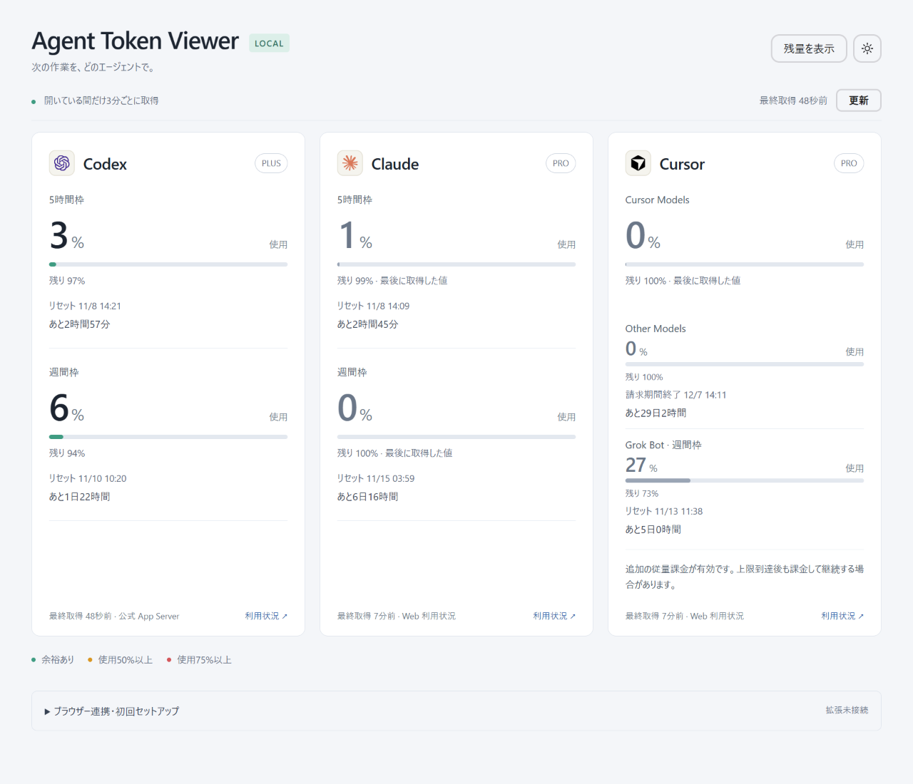

# Agent Token Viewer

Codex・Claude・Cursorの利用枠を同じPCのブラウザーで確認するローカルメーターです。



表示している枠やモデル構成は作者の利用に合わせたものです。個人ごとに使うモデルが違う場合は、取得先やメーター定義を自分でカスタムしてください。

## 画面の操作

- 既定は使用量表示です。「残量を表示」「使用量を表示」で切り替えます。選択はブラウザーに保存します。
- 既定はライトテーマです。ヘッダーのアイコンでダークと切り替えます。選択はブラウザーに保存します。
- 「更新」で手動再取得できます。起動直後は、新しい取得が届くまで更新中と表示します。
- 色は使用量50%以上が黄、75%以上が赤という、このアプリ独自の目安です。

## EdgeまたはChromeから起動する（推奨）

Windows、Node.js 22以上、およびMicrosoft EdgeまたはGoogle Chromeが必要です。外部パッケージのインストールは不要です。

初回設定:

1. Edgeの `edge://extensions` またはChromeの `chrome://extensions` を開き、デベロッパーモードを有効にします。
2. 「パッケージ化されていない拡張機能を読み込む」で `extension` フォルダーを選びます。
3. Edgeでは `install-edge.cmd`、Chromeでは `install-chrome.cmd` を一度実行します。現在のWindowsユーザーのレジストリに、このフォルダーの起動用プログラムと許可する拡張IDを登録します。
4. 拡張を再読み込みします。追加のNative Messaging権限を求められた場合は確認してください。
5. 同じブラウザープロファイルでChatGPT・Cursor・Claudeへログインします。

以後は **拡張アイコンをクリックするだけ** で、アプリが裏で起動し、メーターが開きます。既存のメータータブがあればそのタブを使います。OS再起動後も登録は残るので同じ操作です。start.cmdの実行やコマンド画面の保持は不要です。

起動に失敗した場合は拡張が設定案内を開きます。自動検出できない場合は `install-edge.cmd --id 拡張ID` または `install-chrome.cmd --id 拡張ID` で登録できます。フォルダーやNode.jsの配置を変えた場合は登録し直してください。解除は `uninstall-edge.cmd` または `uninstall-chrome.cmd` で行います。拡張自体もブラウザーの拡張機能管理画面から削除してください。

## 更新と停止

- メーターを開いた直後に取得し、タブが開いている間だけ3分ごとに更新します。背面のタブでも開いていれば更新します。
- 各サービスの取得前に、使用中のブラウザー内にメーターのタブがあることを確認します。
- 最後のメータータブを閉じるか別ページへ移動すると、拡張の定期取得を解除し、進行中のWeb取得を中止します。拡張から起動したアプリも接続切断によって終了します。複数タブがある場合は最後の1枚を閉じるまで動きます。
- ブラウザーを終了すれば拡張から起動したアプリも終了します。
- 異常終了などで画面の終了通知が届かない場合に備えて、画面からのハートビートが150秒以上途絶えると取得を止めます。
- 閉じる直前に送信済みの問い合わせはサービス側で処理される場合があります。

Cookie・サービスの認証トークン・会話本文はアプリへ送信しません。T3プレビューでのログインは通常のEdgeと共有されません。6分より古い値は「古いデータ」と表示します。

## 手動起動（補助）

`start.cmd` または `npm start` でも起動できます。http://127.0.0.1:4317 を開いて使います。この場合もメーターが閉じていれば取得は止まりますが、サーバー自体は起動ウィンドウでCtrl+Cを押すまで待機します。拡張からの起動に切り替える前に手動起動したサーバーを停止してください。

サーバーは127.0.0.1のみで待ち受けます。

## データ元

- Codex: 拡張機能がChatGPTのWebセッションから短期の認証情報を取得し、`/backend-api/wham/usage` の取得に使用します。認証情報は拡張内で一時的に扱い、ローカルアプリへ送信・保存しません。非公開仕様のため動作は環境に依存します。
- Cursor: Webセッションの `/api/usage-summary`。Cursor Modelsは `totalPercentUsed`、Other Modelsは `apiPercentUsed`。残り率は使用率から計算します。請求期間終了の時刻は、利用枠のリセットと同義とは断定しません。Grok Botの週間枠は同じログインの `POST /api/dashboard/get-sand-usage-status` から取得し、個人枠がある場合のみ表示します。Other ModelsとGrok Botはコンパクト表示し、請求期間のリセットはCursor ModelsとOther Modelsの区切りとしてOther側に出します。
- Claude: Webセッションの `/api/organizations/{id}/usage`。5時間・週間・取得可能なモデル別枠を表示します。取得可能な組織が複数あれば取り違え防止のため停止します。

Codex・Cursor・ClaudeのWeb APIは非公開で変更される可能性があります。欠損を残り100%で補完しません。取得失敗時は前回値とエラーを併記します。リセット時刻を過ぎた古い残量は「—」になります。

## Claudeの公式出力による補助連携

任意で `scripts/claude-hook.mjs` をClaude Codeの `statusLine` コマンドに指定できます。公式の `rate_limits` だけを保存します。既存の設定は自動変更しません。設定済みの場合は置き換えずに既存処理と組み合わせてください。ヘッドレス・T3経由でstatusLineが実行されることは保証しません。CLI未使用中は更新されません。

例（絶対パスを実際の配置先に合わせます）:

```json
{"statusLine":{"type":"command","command":"node C:/path/to/agent-token-viewer/scripts/claude-hook.mjs"}}
```

## 保存と検証

`.local/` に最後の取得値と拡張の接続用キーを保存します。Gitには含めません。接続用キーはサービスのAPIキーではありません。アンインストール時は拡張を削除し、サーバーを停止します。

```powershell
npm run check
npm test
```

利用枠をトークン総数から正確に逆算できないため、サービスの利用率を表示します。通知・推奨サービス判定・自動切り替えは含みません。
