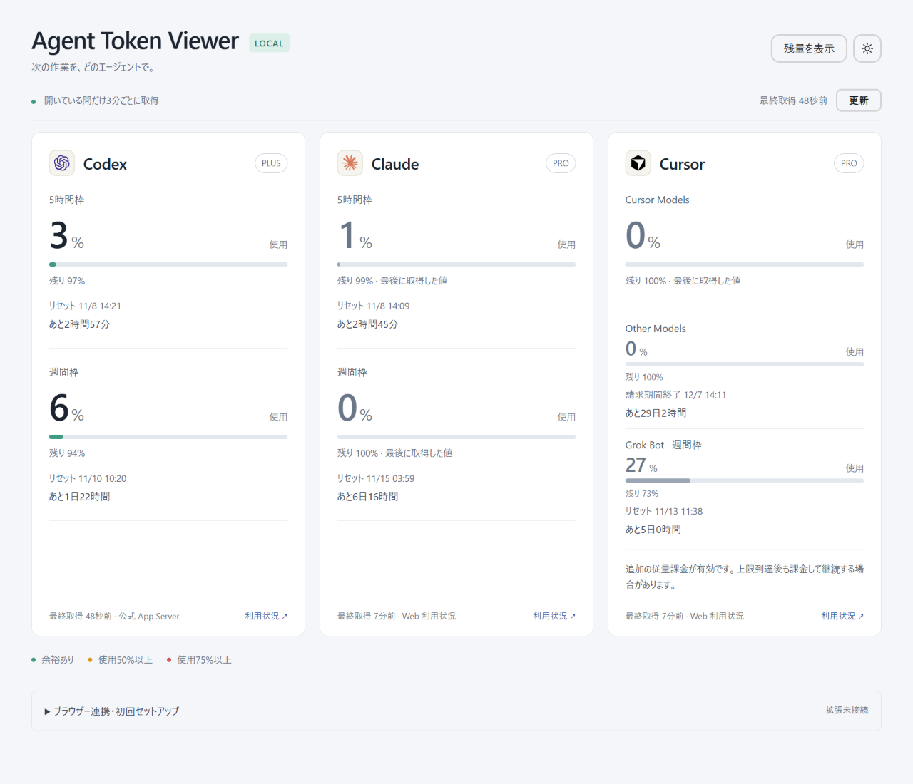

# Agent Token Viewer

Codex・Claude・Cursorの利用枠を、ブラウザーの専用タブで確認するManifest V3拡張です。



## 導入

利用者向けの手順・更新・1.xからの移行・削除方法は [USER_GUIDE.md](USER_GUIDE.md) を参照してください。

EdgeまたはChromeで `extension` フォルダーを読み込み、同じブラウザープロファイルで各サービスへログインして、拡張アイコンをクリックします。Node.js、ローカルサーバー、Native Messaging登録は不要です。

メータータブが開いている間だけ約3分ごとに取得します。使用量／残量、ライト／ダーク、カードの並び順を変更できます。最後の取得値と表示設定はブラウザープロファイル内に保存します。認証情報や会話本文は保存しません。

表示している枠やモデル構成は作者の利用に合わせたものです。個人ごとに使うモデルが違う場合は、取得先やメーター定義をカスタムしてください。

## データ元

- Codex: ChatGPTのWebセッションと `/backend-api/wham/usage`。認証トークンは取得時だけメモリー内で使用します。
- Cursor: `/api/usage-summary`。Grok Botは `POST /api/dashboard/get-sand-usage-status`。請求期間終了は利用枠リセットと同義とは断定しません。経過リングは1か月前からの推定です。
- Claude: `/api/organizations/{id}/usage`。有効な複数組織が見つかった場合は取得を止めます。

非公開APIのためサービス側の変更で動かなくなる場合があります。欠損を残量100%で補完しません。失敗時は前回値とエラーを残し、6分以上前の値は古いデータとして扱います。リセット後の古い値は「—」です。

## 構成

- `extension/background.js`: Web取得、タブ制御、定期取得、画面とのメッセージ。
- `extension/lib/usage.js`: 利用枠の正規化と鮮度判定。
- `extension/lib/state.js`: バージョン付き保存データ、成功・失敗の保存。
- `extension/meter/`: メーター画面。
- `test/`: 正規化・取得・保存・ライフサイクルのテスト。

Service Workerは常駐を前提にしません。再起動時に実在するメータータブから定期取得を復旧します。画面は保存データの変更通知で更新し、経過時刻だけをローカルタイマーで再描画します。

## 開発と検証

開発・配布ZIPの生成にはNode.js 22以上を使用します。追加のnpmパッケージは不要です。

```powershell
npm run check
npm test
npm run test:browser
npm run build
```

`npm run test:browser` はWindowsの標準配置のEdgeを、独立した一時プロファイルでヘッドレス起動します。テスト用応答を使い、拡張の読み込み・表示・更新・設定保持・タブ終了時の停止を確認します。実アカウントへは接続しません。Chromeの実ブラウザー検証と実サービスからの取得確認は別途必要です。

Windowsで `npm run build` を実行すると、チェックとテストの成功後に `dist/agent-token-viewer-<バージョン>.zip` を生成します。拡張本体・利用ガイド・説明書・変更履歴だけを明示して同梱します。Node.js・Git情報・ローカルデータ・開発スクリプトは含めません。`dist/` はGit管理対象外です。

開発中は `extension` を読み込み、変更後に拡張を再読み込みしてメーターを開き直します。各サービスの実取得は、普段のログイン済みプロファイルで確認してください。

## 他のサービスを追加する

1. `extension/background.js` に取得処理を追加し、必要最小限の項目だけを正規化へ渡します。
2. `extension/lib/usage.js` に使用率・リセット時刻・窓の長さを返す正規化処理を追加します。
3. `extension/lib/state.js` のサービス一覧と、`extension/meter/app.js` の名前・アイコン・リンクを追加します。
4. `extension/manifest.json` に必要なアクセス先を追加します。
5. テストと配布ファイル一覧を更新し、`npm run check` と `npm test` を実行します。

## バージョン管理

アプリと拡張は同じ `major.minor.patch` を使います。互換性を損なう変更はmajor、機能追加はminor、修正はpatchを更新します。

1. `npm run version:set -- 2.0.1` で `package.json` と拡張の `manifest.json` を更新します。
2. `CHANGELOG.md` に変更内容と日付を記載します。
3. チェック・テスト・配布検証後にコミットし、必要に応じてGitタグを付けます。

2.0.0は拡張単体への移行に伴う互換性変更です。旧ローカルURL、Native Messaging、Claude CodeのstatusLineファイル連携を廃止しました。
